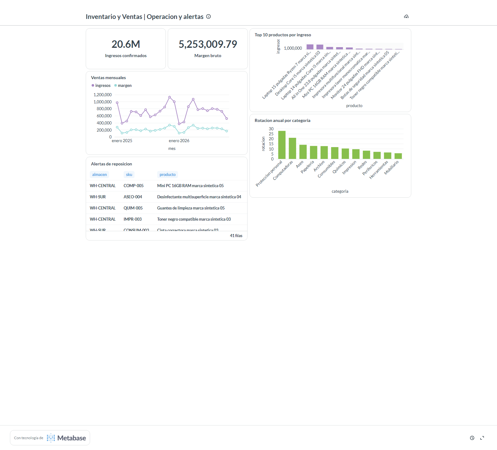
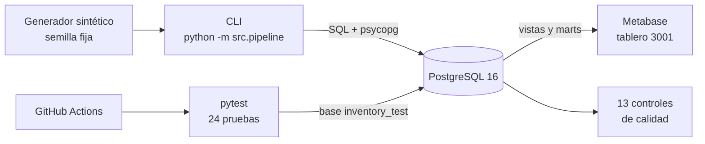

# Sistema de inventario y ventas multi-almacén (PostgreSQL)

Proyecto de portafolio de **Data Analyst / Data Engineering junior**: un sistema
transaccional de inventario y ventas para dos almacenes, modelado en PostgreSQL,
con reglas de negocio en la base de datos, controles de calidad, consultas
analíticas y un tablero en Metabase.

No es un CRUD web ni una API: la interfaz es una **CLI** para operar y validar
el sistema, y **Metabase** para explorar los datos.

> **Datos sintéticos.** No se usa información real de personas ni empresas.
> Los nombres, documentos y RUC son inventados y solo cumplen el formato
> peruano. Las cifras sirven para demostrar el diseño, no para sacar
> conclusiones de mercado.



## Qué resuelve

- Registra **compras** a proveedores y **ventas** a clientes en dos almacenes.
- Mantiene el stock como un **libro mayor inmutable** (`stock_movements`) y un
  saldo materializado (`stock_levels`) que se actualiza por trigger.
- Impide vender sin stock, cancelar compras que dejarían saldo negativo y editar
  documentos confirmados.
- Separa el costo y el precio **congelados** al momento de la venta del costo
  actual del catálogo.
- Calcula totales con IGV configurable (18% por defecto).
- Expone vistas y *marts* para ventas, margen, rotación, clasificación ABC,
  alertas de reposición y capital inmovilizado.

## Stack

| Pieza | Tecnología |
|---|---|
| Base de datos | PostgreSQL 16 |
| Contenedores | Docker Compose |
| CLI y generador de datos | Python 3.12 (`psycopg` 3) |
| BI | Metabase |
| Pruebas | pytest |
| CI | GitHub Actions (PostgreSQL 16) |

## Resultados del dataset sintético

Semilla fija `42`, 24 meses (2024-12 a 2026-11), ~9 ventas base por día.

| Métrica | Valor |
|---|---:|
| Ventas registradas | 6,519 |
| Ventas confirmadas | 6,323 |
| Cancelaciones | 196 (3.01%) |
| Líneas de venta | 13,023 |
| Unidades vendidas | 30,129 |
| Ingresos netos (sin IGV) | S/ 17,437,399.08 |
| Ingresos con IGV | S/ 20,576,131.76 |
| COGS | S/ 12,184,389.29 |
| Margen bruto | S/ 5,253,009.79 (30.12%) |
| Ticket promedio (con IGV) | S/ 3,254.17 |
| Compras confirmadas | 1,630 |
| Movimientos de stock | 15,485 |
| Valor de inventario (costo estándar) | S/ 424,380.36 |
| Alertas de reposición | 41 |

Hallazgos que el modelo permite sostener:

- El negocio es **Pareto**: 7 productos de clase A concentran 80.39% de los
  ingresos; 36 productos de clase C aportan 4.48%.
- Tres productos explican 56.07% de los ingresos, y el primero solo, 23.08%.
- El proveedor top concentra 23.66% de las compras; los cinco primeros, 79.29%.
- La estacionalidad es marcada: diciembre vende 35.7% más que el promedio y
  noviembre 13.8% más; enero y febrero venden 47.6% y 39.6% menos.
- La rotación anual por categoría va de 5.63 a 27.93 vueltas (13 a 65 días de
  inventario), con un promedio simple de 12.30.
- Hay 3 combinaciones producto/almacén sin stock y 25 por debajo del mínimo; el
  capital inmovilizado en productos sin venta reciente es pequeño (S/ 2,483.31),
  concentrado en EPP del almacén Sur.

## Arquitectura



### Modelo en capas

- `core`: tablas operativas en 3NF, enums, funciones y triggers.
- `reporting`: vistas de solo lectura y dos vistas materializadas.
- `audit`: resultados históricos de los controles de calidad.

### Inventario: libro mayor + saldo

`core.stock_movements` es **append-only** (UPDATE y DELETE bloqueados por
trigger). Cada entrada, salida, venta, compra, transferencia y ajuste genera una
fila con signo coherente. `core.stock_levels` guarda el saldo por producto y
almacén y se mantiene con un trigger `AFTER INSERT` que hace un `UPDATE`
atómico:

```sql
UPDATE core.stock_levels
   SET quantity = quantity + NEW.quantity_delta
 WHERE product_id = NEW.product_id
   AND warehouse_id = NEW.warehouse_id
   AND quantity + NEW.quantity_delta >= 0;
```

Si no hay fila que actualizar, la operación falla: **nunca queda stock
negativo**. Esta condición también resuelve la carrera entre dos ventas que
compiten por la última unidad (hay una prueba de concurrencia).

### Reglas explícitas, no triggers ocultos

Confirmar y cancelar son funciones idempotentes:

- `core.fn_register_sale`, `core.fn_confirm_sale`, `core.fn_cancel_sale`
- `core.fn_register_purchase`, `core.fn_confirm_purchase`, `core.fn_cancel_purchase`
- `core.fn_transfer_stock`, `core.fn_adjust_stock`, `core.fn_set_min_stock`

Los triggers de cabecera verifican una variable de sesión
(`inventory.posting`) para que un `UPDATE` directo a `CONFIRMED` falle y obligue
a usar la función. Así el flujo de negocio queda visible y auditable.

## Puesta en marcha

Requisitos: Docker Desktop, Python 3.12 y PowerShell o Bash.

```bash
docker compose up -d
python -m venv .venv

# Windows PowerShell
.\.venv\Scripts\Activate.ps1
# Linux / macOS
# source .venv/bin/activate

pip install -r requirements-dev.txt
python -m src.pipeline schema
python -m src.pipeline seed --reset
python -m src.pipeline quality
python -m src.pipeline queries --limit 20
```

PostgreSQL queda en `localhost:5433` (base `inventory`, usuario `inventory`,
clave `inventory_dev`). Metabase en `http://localhost:3001`.

> Los valores por defecto ya coinciden con `docker-compose.yml`. Si se cambian,
> copiar `.env.example` a `.env`.

## CLI

| Comando | Qué hace |
|---|---|
| `python -m src.pipeline schema` | Aplica el DDL completo (idempotente). |
| `python -m src.pipeline seed --reset` | Regenera los datos sintéticos. |
| `python -m src.pipeline quality` | Ejecuta 13 controles y los guarda en `audit`. |
| `python -m src.pipeline queries` | Corre las 11 consultas de negocio. |
| `python -m src.pipeline demo` | Demuestra venta, descuento de stock, cancelación y rechazo por falta de stock. |
| `python -m src.pipeline refresh` | Refresca los *marts* con `CONCURRENTLY`. |
| `python -m src.pipeline benchmark` | Mide planes con y sin índices y escribe `docs/06_performance.md`. |
| `python -m src.pipeline metabase` | Configura conexión, colección, tarjetas y tablero por API. |
| `python -m src.pipeline info` | Resume volúmenes y totales. |
| `python -m src.pipeline all --reset` | Esquema + datos + calidad + consultas. |

## Pruebas y calidad

```bash
python -m pytest -q
```

- **24 pruebas** en una base `inventory_test` independiente; no tocan `inventory`.
- Cubren totales e IGV, inmutabilidad, idempotencia, compras, transferencias,
  stock mínimo, vistas y una **prueba de concurrencia** con dos hilos.
- **13 controles de calidad** verifican conciliación saldo vs libro mayor,
  posteo de ventas/compras, totales, fechas, ABC y configuración de IGV.
- CI en `.github/workflows/ci.yml` levanta PostgreSQL 16 y ejecuta el esquema dos
  veces (para validar idempotencia) y toda la suite.

Resultado actual: `13/13` controles aprobados y `24 passed`.

## Rendimiento

`docs/06_performance.md` se genera con `EXPLAIN (ANALYZE, BUFFERS)` y compara
cada consulta con **todos** sus índices candidatos y sin ellos:

| Consulta | Con índice | Sin índice | Aceleración |
|---|---:|---:|---:|
| Movimientos de un producto/almacén (30 días) | 0.440 ms | 3.741 ms | **8.50×** |
| Ventas confirmadas de un mes | 2.338 ms | 4.714 ms | **2.02×** |
| Top 10 productos por ingreso | 9.152 ms | 10.342 ms | 1.13× |

La tercera consulta es una agregación global: el índice no reduce el trabajo
porque hay que leer y agrupar casi toda la tabla. El reporte lo dice en vez de
afirmar que todo índice acelera.

## Dashboard en Metabase

```bash
python -m src.pipeline metabase
```

Crea una conexión, una colección, seis preguntas nativas y un tablero con:

1. Ingresos confirmados (escalar)
2. Margen bruto (escalar)
3. Ventas mensuales (línea)
4. Top 10 productos por ingreso (barras)
5. Alertas de reposición (tabla)
6. Rotación anual por categoría (barras)

Credenciales locales de desarrollo: `analyst@inventory.local` /
`Inventory2026!`. El script es idempotente; se puede ejecutar varias veces.

## Estructura

```text
inventory-sales-system/
├─ sql/
│  ├─ 00_schema/      # 01 esquemas, 02 tablas, 03 índices, 04 funciones/triggers,
│  │                  # 05 vistas, 06 marts
│  ├─ 20_checks/      # controles de calidad
│  └─ 30_queries/     # 11 consultas de negocio
├─ src/
│  ├─ config.py       # variables de entorno
│  ├─ db.py           # conexión y ejecución de SQL
│  ├─ seed.py         # generador sintético reproducible
│  ├─ pipeline.py     # CLI
│  ├─ demo.py         # demostración del flujo
│  ├─ benchmark.py    # EXPLAIN con/sin índices
│  └─ setup_metabase.py
├─ tests/             # 24 pruebas (incluye concurrencia)
├─ docs/              # decisiones, modelo, consultas, calidad, rendimiento
└─ docker-compose.yml
```

## Documentación

- [Requerimientos](docs/01_requerimientos.md)
- [Modelo entidad-relación](docs/02_modelo_er.md)
- [Decisiones de diseño](docs/03_decisiones.md)
- [Consultas de negocio](docs/04_consultas.md)
- [Calidad y pruebas](docs/05_calidad.md)
- [Rendimiento](docs/06_performance.md)
- [Metabase](docs/07_metabase.md)
- [Limitaciones y siguientes pasos](docs/08_limitaciones.md)

## Limitaciones

- Datos **sintéticos**; no representan una empresa real.
- Un solo rol de base de datos para desarrollo; no hay separación de permisos
  por área ni auditoría de usuarios.
- No hay devoluciones parciales, notas de crédito, múltiples monedas ni
  facturación electrónica.
- El costo de inventario actual usa el costo estándar del catálogo; no se
  recalcula por promedio ponderado ni FIFO.
- Metabase corre con H2 embebido, apto para demo local, no para producción.

Ver [docs/08_limitaciones.md](docs/08_limitaciones.md) para el detalle.

## Licencia

MIT. Ver [LICENSE](LICENSE).
