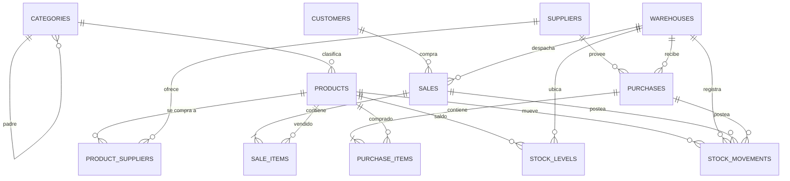

# Modelo entidad-relación

## Diagrama

## Tablas operativas (`core`)

### Catálogos

| Tabla | Rol | Claves y restricciones |
|---|---|---|
| `categories` | Categorías jerárquicas (4 raíces, 12 subcategorías). | `parent_id` autoreferenciado; `code` y `name` únicos; no puede ser su propio padre. |
| `warehouses` | Almacenes físicos. | `code` único con formato `WH-*`. |
| `suppliers` | Proveedores. | `ruc` único de 11 dígitos (solo formato); `lead_time_days` entre 1 y 120. |
| `products` | Catálogo con precio, costo y stock mínimo de referencia. | `sku` único; `unit_price >= unit_cost`; unidad permitida. |
| `product_suppliers` | Relación N:M producto–proveedor con costo y lead time propios. | PK compuesta; un solo proveedor preferido por producto (índice parcial único). |
| `customers` | Clientes con DNI, RUC o carné de extranjería. | `(doc_type, doc_number)` único; formato por tipo de documento. |

### Ventas

| Tabla | Rol | Puntos clave |
|---|---|---|
| `sales` | Cabecera de venta. | `sale_number` único (`V-YYYYMM-######`); estado `DRAFT`/`CONFIRMED`/`CANCELLED`; totales con `CHECK total = subtotal + tax`; timestamps coherentes con el estado. |
| `sale_items` | Líneas de venta. | Una línea por producto; `unit_price` y `unit_cost` congelados; `line_subtotal` y `line_cost` generadas; descuento 0–100%. |

### Compras

| Tabla | Rol | Puntos clave |
|---|---|---|
| `purchases` | Cabecera de compra. | `purchase_number` único (`C-YYYYMM-######`); mismas guardas que ventas. |
| `purchase_items` | Líneas de compra. | Costo congelado; `line_subtotal` generada. |

### Inventario

| Tabla | Rol | Puntos clave |
|---|---|---|
| `stock_levels` | Saldo materializado por producto/almacén. | PK `(product_id, warehouse_id)`; `quantity >= 0`; se mantiene solo por trigger. |
| `stock_movements` | Libro mayor inmutable. | `quantity_delta <> 0`; signo coherente con el tipo; FK real a `sales` o `purchases` según el tipo; índices únicos parciales para idempotencia. |

### Configuración y auditoría

| Tabla | Rol |
|---|---|
| `core.settings` | Parámetros como `igv_rate = 0.18`. |
| `audit.quality_results` | Una fila por control ejecutado, con fecha y resultado. |

## Cómo se relaciona el inventario con los documentos

`stock_movements` no usa una referencia polimórfica sin integridad. Tiene dos
columnas opcionales, `sale_id` y `purchase_id`, y un `CHECK` que exige
exactamente una fuente según el tipo:

| Tipo | `sale_id` | `purchase_id` |
|---|---|---|
| `SALE`, `SALE_CANCEL` | obligatorio | nulo |
| `PURCHASE`, `PURCHASE_CANCEL` | nulo | obligatorio |
| `ADJUSTMENT_IN/OUT`, `TRANSFER_IN/OUT` | nulo | nulo |

Así, una venta no puede “apuntar” a una compra y las claves foráneas siguen
siendo reales.

Los índices únicos parciales:

- `(sale_id, product_id, warehouse_id, movement_type)` cuando `sale_id` no es nulo.
- `(purchase_id, product_id, warehouse_id, movement_type)` cuando `purchase_id` no es nulo.

impiden postear dos veces el mismo documento (idempotencia a nivel de datos).

## Por qué 3NF y no un esquema estrella

Las tablas operativas están normalizadas para evitar anomalías de actualización:
un producto tiene una sola categoría y un solo precio de catálogo; los documentos
no repiten datos del cliente ni del proveedor. La analítica se resuelve con
vistas (`reporting`) y dos vistas materializadas para el tablero. No se copian
hechos a tablas manualmente.

## Volumen del dataset de demostración

| Entidad | Filas |
|---|---:|
| Categorías | 16 |
| Almacenes | 2 |
| Productos | 60 |
| Proveedores | 20 |
| Clientes | 200 |
| Ventas | 6,519 (6,323 confirmadas, 196 canceladas) |
| Líneas de venta | 13,023 |
| Compras | 1,630 confirmadas |
| Movimientos de stock | 15,485 |
| Combinaciones producto/almacén con saldo | 120 |

## Invariantes que el modelo garantiza

1. No existe stock negativo.
2. El saldo de cada producto/almacén es igual a la suma de su libro mayor.
3. Una venta o compra confirmada no se edita.
4. Un documento no se postea dos veces.
5. Los movimientos no se actualizan ni se borran.
6. El total de una venta/compra es subtotal + IGV.
7. El precio y el costo de una línea no cambian después de la venta.
8. Una transferencia conserva el stock total del sistema.
