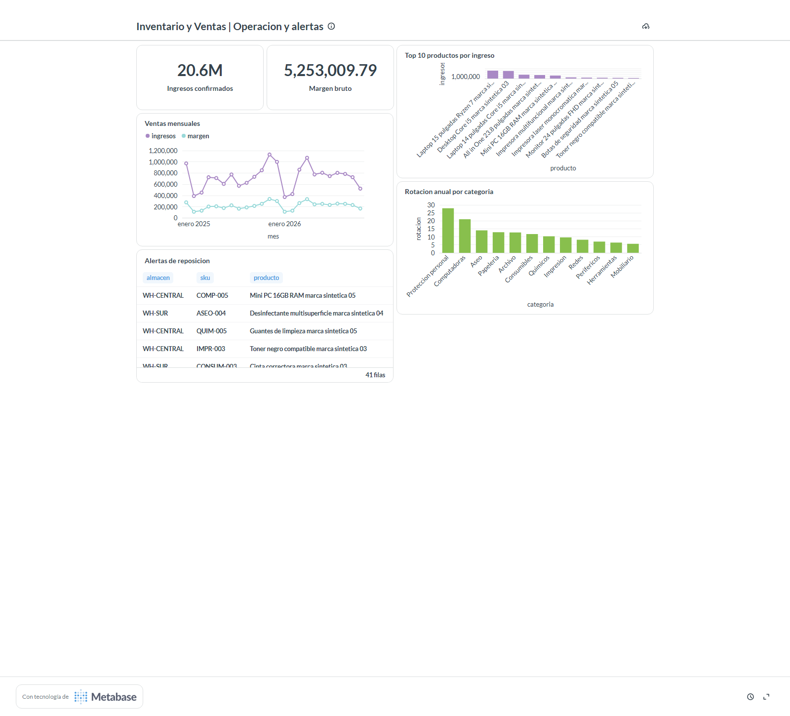

# Dashboard en Metabase

El tablero es la capa de exploración visual. No reemplaza a la CLI ni contiene
lógica de negocio: solo consulta vistas de `reporting`.



## Cómo se levanta

```bash
docker compose up -d
python -m src.pipeline metabase
```

El comando espera a que Metabase responda en `http://localhost:3001`, inicia
sesión y configura todo por API:

1. Completar el asistente inicial si es la primera vez (usuario, idioma `es`).
2. Crear la conexión `Inventario y Ventas (PostgreSQL)` apuntando al servicio
   `postgres:5432` dentro de la red de Docker.
3. Crear la colección `Inventario y Ventas`.
4. Crear o actualizar seis preguntas nativas.
5. Crear el tablero `Inventario y Ventas | Operación y alertas`.
6. Acomodar las tarjetas en una grilla de 24 columnas.
7. Habilitar el enlace público del tablero.

Se puede ejecutar varias veces: busca por nombre antes de crear y actualiza lo
que ya existe. La contraseña y el correo se leen de `.env` (ver `.env.example`).

Credenciales locales de desarrollo:

| Campo | Valor |
|---|---|
| URL | `http://localhost:3001` |
| Usuario | `analyst@inventory.local` |
| Contraseña | `Inventory2026!` |

> Son credenciales de demo local. No usar en un entorno expuesto.

## Las seis tarjetas

| # | Tarjeta | Tipo | Fuente | Qué muestra |
|---:|---|---|---|---|
| 1 | Ingresos confirmados | Escalar | `core.sales` | Suma de `total` (con IGV) de ventas confirmadas. |
| 2 | Margen bruto | Escalar | `core.sale_items` | `line_subtotal - line_cost` de ventas confirmadas. |
| 3 | Ventas mensuales | Línea | `reporting.mv_ventas_mensuales` | Ingresos y margen por mes. |
| 4 | Top 10 productos por ingreso | Barras | `reporting.v_abc_productos` | Los 10 SKU con más ingreso. |
| 5 | Alertas de reposición | Tabla | `reporting.v_alertas_reposicion` | Stock, mínimo, cobertura y prioridad. |
| 6 | Rotación anual por categoría | Barras | `reporting.v_rotacion_actual` | Vueltas anualizadas por categoría. |

### Disposición

La grilla tiene 24 columnas:

```text
┌──────────────────┬──────────────────┐
│ Ingresos (6)     │ Margen (6)       │  fila 0
├──────────────────┴──────────────────┤
│ Ventas mensuales   │ Top 10 (12)    │  fila 3
├────────────────────┼────────────────┤
│ Alertas (12)       │ Rotación (12)  │  fila 9
└────────────────────┴────────────────┘
```

La API de Metabase no siempre respeta el layout al agregar tarjetas: puede
dejarlas todas en `row=0, col=0`. Por eso `_layout_dashboard()` hace un `PUT`
explícito y asigna `row`, `col`, `size_x` y `size_y`.

### Por qué el escalar de ingresos usa `total` y las consultas usan `line_subtotal`

El escalar responde “cuánto facturó el negocio”, incluido IGV, que es lo que un
dueño espera ver. Las consultas analíticas usan `line_subtotal` para comparar
ingresos contra COGS sin impuesto. Son dos preguntas distintas y la diferencia
está documentada para que no parezca un descuadre.

## Enlace público

El script habilita un enlace de solo lectura:

```text
http://localhost:3001/public/dashboard/2b203d3f-371b-406e-9f61-cd0e755f8e77
```

Sirve para compartir una captura o revisar el tablero sin iniciar sesión. El
identificador se genera una vez y no cambia mientras no se elimine el tablero.

## Reproducir desde cero

Si se borra el volumen `inventory_metabase_data`, Metabase vuelve a pedir el
asistente. El comando `metabase` lo completa con los valores de `.env` y recrea
todo. El orden recomendado es:

```bash
docker compose down
docker compose up -d
python -m src.pipeline schema
python -m src.pipeline seed --reset
python -m src.pipeline metabase
```

La conexión de Metabase apunta a `postgres:5432` (red interna), no a
`localhost:5433`. Si se cambia el nombre del servicio en `docker-compose.yml`,
hay que ajustar `_ensure_database()` en `src/setup_metabase.py`.

## Problemas comunes

| Síntoma | Causa probable | Solución |
|---|---|---|
| `Metabase no respondió en 240s` | El contenedor todavía está arrancando. | `docker compose ps` y esperar el healthcheck; volver a ejecutar. |
| `ERR_CONNECTION_REFUSED` en `3001` | Docker Desktop se pausó (Resource Saver). | Abrir Docker Desktop, esperar ~45 s y `docker compose up -d`. |
| El tablero se ve superpuesto | Layout sin aplicar. | Volver a ejecutar `python -m src.pipeline metabase`. |
| Las tarjetas no cargan datos | La base `inventory` está vacía. | `python -m src.pipeline seed --reset`. |
| Error de conexión desde Metabase | Se cambió el puerto o el nombre del servicio. | Revisar `.env` y `docker-compose.yml`. |

Metabase corre con H2 embebido y `-Xmx1g`, suficiente para esta demo. Para
producción se usaría PostgreSQL como base de aplicación y un despliegue con
autenticación real; está fuera del alcance.

## Captura

La imagen `docs/img/dashboard.png` se generó con Chrome headless contra el
enlace público, ventana de 1600×1450. No se editó el contenido: si se regenera
el dataset, conviene volver a tomarla.
